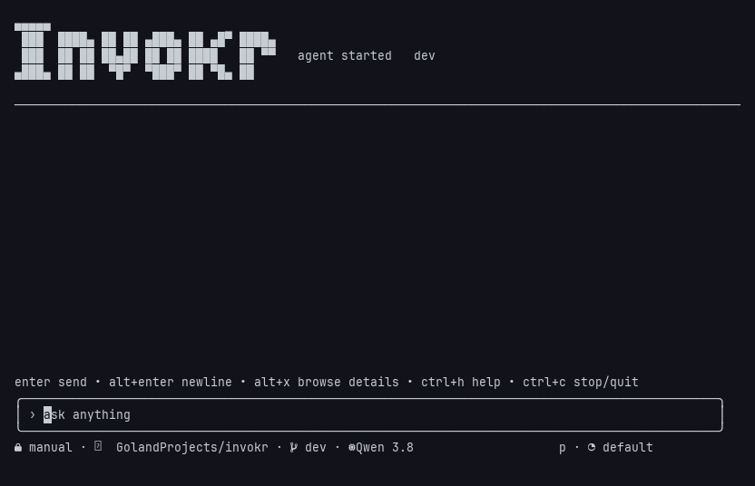

<p align="center"><strong>Invokr</strong></p>
<p align="center">A terminal agent built for local models.</p>

[](https://github.com/invokr-ai/invokr/releases/latest)
[](https://github.com/invokr-ai/invokr/actions/workflows/ci.yml)
[](https://github.com/invokr-ai/invokr/actions/workflows/e2e.yml)



---

Invokr is an agent harness optimised for small local models, while remaining
compatible with any OpenAI-compatible API. Through
[go-inference-router](https://github.com/rivt-ai/go-inference-router) it also
supports hosted providers such as Anthropic, Bedrock and OpenAI. It ships with a
core tool set that the agent can extend by writing its own tools. Tool actions
pass through approval policy; Linux namespace sandboxing confines supported
execution paths when available. See [Platforms](#platforms) for fallback behavior.

### Installation

```bash
curl -fsSL https://raw.githubusercontent.com/invokr-ai/invokr/main/install.sh | sh
```

The installer supports Linux and macOS. It selects the release for your OS and
architecture, verifies its checksum and installs to `~/.local/bin`. With Go 1.26+
you can also run:

```bash
go install github.com/invokr-ai/invokr@latest
```

Building from source is covered in [CONTRIBUTING.md](CONTRIBUTING.md).

### Getting started

| Command | What it does |
|---|---|
| `invokr setup` | Configures the model endpoint and optional features, then saves the config. |
| `invokr` | Starts the agent in the interactive TUI. |
| `invokr exec "…"` | Runs the same agent without a terminal, for scripts and CI. |
| `invokr --resume` | Selects a past session from a menu and continues it. |
| `invokr doctor` | Diagnoses the provider, sandbox, interpreters and MCP servers. |

On a new install, run `invokr setup`, then `invokr doctor` to confirm everything
is in place before starting the agent.

### Connecting a model

`invokr setup` stores the provider URL and model, after which `invokr` is all
that is needed. If no model is set, Invokr uses the first model the server lists. A llama.cpp `llama-server` works without extra configuration:

```bash
llama-server -m ./model.gguf --port 8080   # then give setup http://localhost:8080
```

Ollama (`http://localhost:11434/v1`) and any other `/v1` OpenAI-compatible
endpoint are also supported. To use a different endpoint or model for a single
run without changing the config, pass `--base-url` and `--model`.

Small models select tools more reliably from a short list. `--tools` advertises
only the named tools, e.g. `invokr --tools read,edit,shell`.

For hosted models, see [Hosted providers](#hosted-providers) below.

To manage local runtimes, see
[InferenceRig](https://github.com/rivt-ai/InferenceRig), a local control plane
for llama.cpp and Apple MLX with profiles, a model catalog and hardware fit
estimates. Provide setup with the `listen:` host and port of a profile; nothing
else changes.

### Modes

`Shift+Tab` cycles between three approval modes; `/mode` selects one directly.

- **Manual** (default): asks before anything with side effects.
- **Auto**: approves workspace edits and commands that can prove they stay
  confined. Unconfined execution, protected edits and publishing still ask.
- **Plan**: read-only; source writes and publishing are denied.

`--yolo` disables approvals and the sandbox for the session. It is available
only from the CLI and displays a persistent warning while active.

For scripts and CI, `invokr exec` runs the same agent without a terminal. It
denies every approval by default; opt in per tier with `--allow <tier>`:

```bash
invokr exec --allow read-only "list the failing tests"
git diff | invokr exec -                  # prompt on stdin
invokr exec --json "…" | jq .             # JSONL ledger of every tool call
invokr exec --last "now write the fix"    # continue the last session
```

### Features

- **Sandboxed side effects.** Shell, toolbox tools and the Python interpreter
  use rootless Linux namespaces with a stripped environment when available.
  Ordinary allowlisted shell commands can run on the host when namespaces are
  unavailable; interpreters and scripts need an explicit unsandboxed opt-in.
- **Supply-chain control.** Python dependencies resolve through allowlisted
  hosts and are checked against allow/deny lists and a release-age cooldown.
  The exact resolved set is approved before anything is installed.
- **Long-term memory.** Markdown + SQLite, with optional in-process vector
  recall, forgetting and archival.
- **Sessions.** Lossless resume (`invokr --resume`) and search across past
  sessions (`invokr sessions`).
- **Subagents, jobs and MCP.** Spawn bounded subagents, schedule cron jobs and
  connect stdio or streamable-HTTP MCP servers.
- **Skills.** Install `SKILL.md` instruction packs the agent loads on demand.
  Find them with `invokr skills search <term>`, then `invokr skills install <name>`.
- **Chat transports.** Run the agent as a Telegram or Signal bot with
  `invokr bot serve`.
- **Update detection.** The banner notes when a newer release exists; the check
  never blocks startup or the UI, and it stays off for unstamped builds. Set
  `INVOKR_NO_UPDATE_CHECK` to any non-empty value to skip the lookup.

### Platforms

- **Linux:** fully supported, and the only platform with the namespace sandbox.
- **macOS:** supported with limitations. Ordinary allowlisted shell commands
  run on the host without a namespace sandbox. Routed scripts, interpreters,
  and toolbox tools need the Docker sandbox with a prebuilt `linux/amd64` image
  (`INVOKR_SANDBOX_IMAGE`) or an explicit `INVOKR_TOOLBOX_ALLOW_UNSANDBOXED=1`.
- **Windows:** not supported.

Sandboxing is Linux-only by design, as it relies on user namespaces. Run
`invokr doctor` to see what is available on your machine.

### Documentation

- [docs/reference.md](docs/reference.md): the full manual.
- [docs/security-model.md](docs/security-model.md): what each execution path can do and where the boundaries are not.
- [docs/memory.md](docs/memory.md): memory tiers, models and forgetting.
- [docs/agents/README.md](docs/agents/README.md): codebase orientation.

### Contributing

Read [CONTRIBUTING.md](CONTRIBUTING.md) before opening a pull request. Lint
enforces complexity and code-size budgets, so a change can fail on size alone.

Report security issues through [SECURITY.md](SECURITY.md), not public issues.

### Hosted providers

Anthropic, Bedrock and OpenAI run through
[go-inference-router](https://github.com/rivt-ai/go-inference-router). Each
provider runs as a separate process. `invokr provider install` downloads it
from a signed release registry, verifies it and stores your API key:

```bash
invokr provider install anthropic        # prompts for the API key
invokr config use anthropic              # switch the active profile
invokr
```

To store a key non-interactively:

```bash
printf %s "$ANTHROPIC_API_KEY" | invokr provider set-key anthropic
```

---

Released under the MIT License. See [LICENSE](LICENSE).
