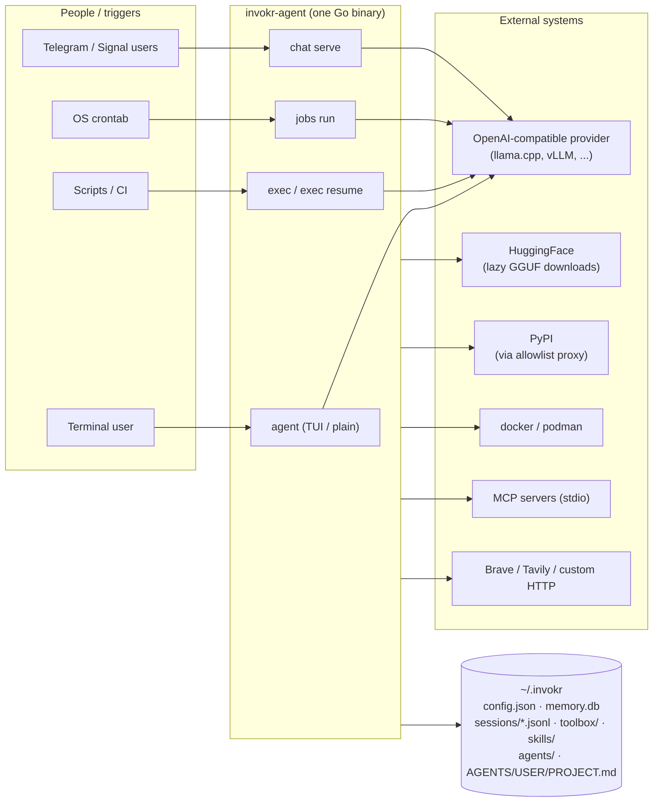
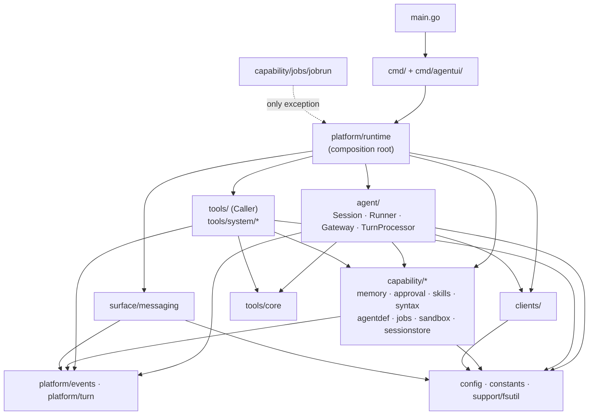
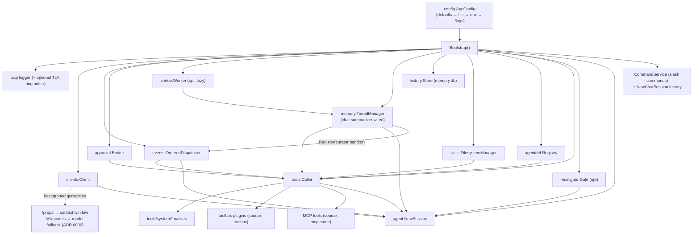
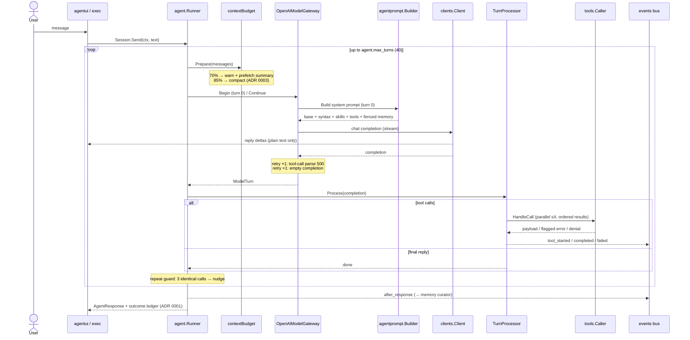
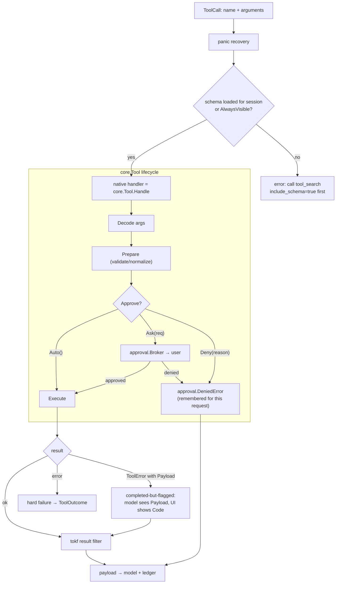
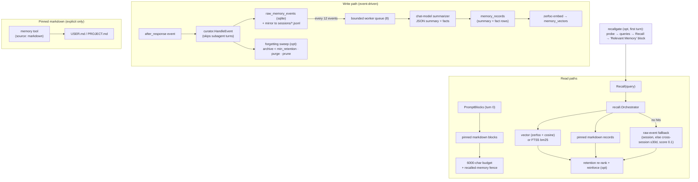
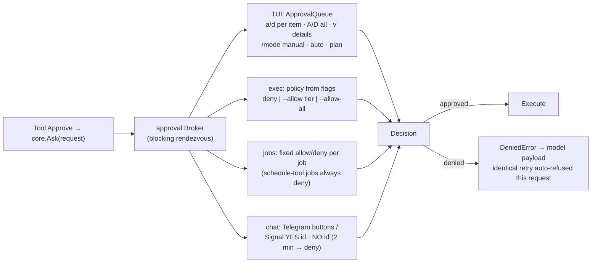
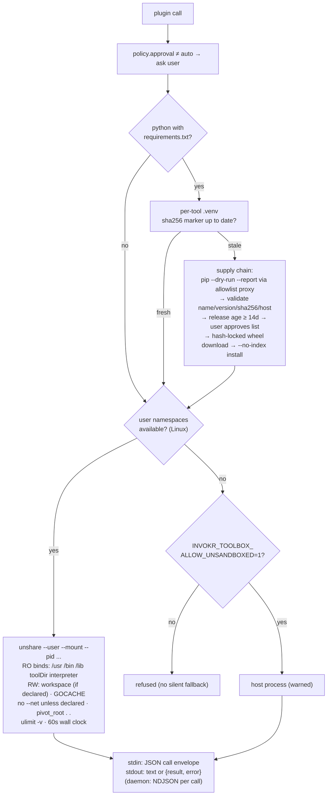
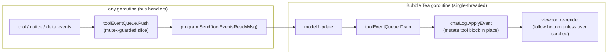
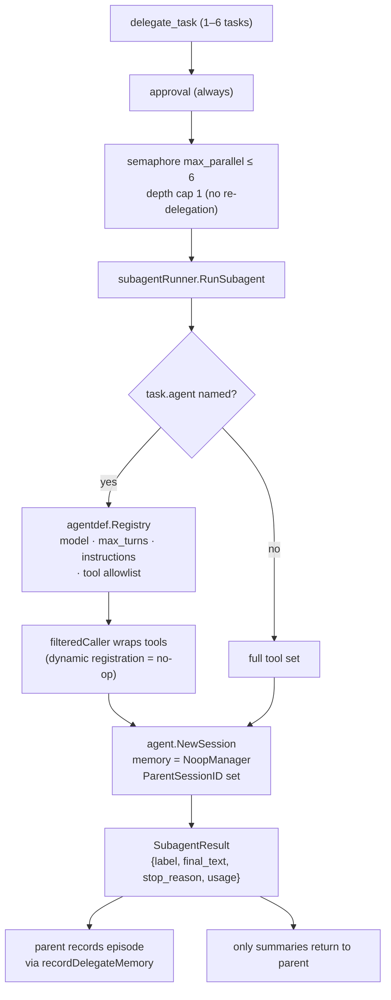

# 16 — Diagrams

The same ground as guides 01–15, drawn. Ordered from the outside world down to
subsystem internals. All names are real packages/types; if a diagram and the
code disagree, the code wins — fix the diagram.

View these rendered: `make diagram-view` (generates an HTML page and opens it
in your browser).

## 1. System context — Invokr and the outside world

## 2. Layer map — who may import whom

Arrows point at dependencies. `capability/*` never imports `platform/runtime`
(sole sanctioned exception: `capability/jobs/jobrun`, which exists to hold that
import without a cycle).

## 3. Bootstrap — what `platform/runtime.Bootstrap` wires

## 4. One turn — sequence

## 5. Tool dispatch — inside `Caller.HandleCall` and `core.Tool[A]`

## 6. Memory — write and read paths

## 7. Approvals — one broker, four answerers

## 8. Toolbox invocation — sandbox and supply chain

## 9. TUI threading — the one rule

Never touch model state from a handler goroutine — push and wake.

## 10. Subagents — delegate_task

